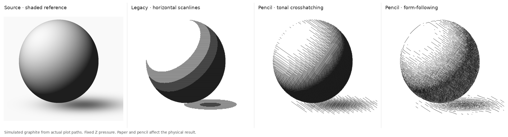

# Ender Plotter Slicer

A Python/Qt desktop tool for turning vector artwork, text and raster images into pen-plotter G-code for Ender-3-style machines and the **ELEGOO Neptune 2**.

The project is intended for 3D-printer-to-plotter conversions where a pen holder is mounted to the toolhead and pen pressure is controlled through Z moves.

## Features

- 2D page layout with a millimetre grid
- Text-to-path generation
- SVG import
- PNG/JPG/BMP/WEBP/TIFF raster import
- Continuous-tone pencil crosshatching for photos and portraits
- Form-following curved hatching and preserved highlights
- Pencil presets with physical stroke width and graphite darkness calibration
- Source / actual-path preview before import, with cancellable background conversion
- Reprocess imported drawings without losing their page placement
- Scalable nearest-endpoint path ordering for dense drawings
- G-code preview with travel visibility and motion-time lower bounds
- Marlin-compatible XY/Z-only output
- Built-in profiles for:
  - ELEGOO Neptune 2 Pen Plotter
  - Ender 3 Pen Plotter
  - Ender 3 Pen Plotter Rotated Bed
- Scrollable settings panel for smaller screens
- JSON project files: `*.plotproj.json`

## Pencil drawing comparison



This comparison renders the actual plot paths. The physical result depends on the pencil and paper.

## Quick start on Windows

1. Install **Python 3.10 or newer**.
2. Download or clone this repository.
3. Double-click:

```text
start_ender_plotter_slicer.bat
```

The launcher creates a local `.venv`, installs all required packages, verifies the imports and starts the app.

## Manual start

```bash
python -m venv .venv

# Windows
.venv\Scripts\activate

# Linux/macOS
source .venv/bin/activate

pip install -r requirements.txt
python -m ender_plotter_slicer
```

The old direct entry point also works:

```bash
python main.py
```

## Raster image import

Use **File → Import Image...** to import:

- PNG
- JPG / JPEG
- BMP
- WEBP
- TIFF

The app converts image tone into real plotter paths. **Pencil · balanced** is the default. It uses angled strokes, continuous density and extra hatch directions in shadows. **Pencil · fine portrait** preserves more detail. **Pencil · form-following** adds curved marks based on local image structure.

1. Open **File → Import Image...**.
2. Set the drawing size and select a preset.
3. Enter the width and approximate darkness of a real plotted pencil stroke.
4. Use **Update Preview**. Compare the source with the simulated graphite paths.
5. Use **Import Drawing**. Select **Preview / Export G-Code...** to inspect machine moves and drawing time.

Use **Edit → Adjust Image Hatching...** to revise a selected drawing. Import settings and geometry are saved in the project. Existing projects remain readable.

Read [Pencil drawing and raster import](docs/raster_import.md) for all settings, physical calibration, lift strategy and the limits of the preview.

## ELEGOO Neptune 2 profile

The default profile is:

```text
ELEGOO Neptune 2 Pen Plotter
```

It is configured for:

- 220 × 220 mm XY work area
- 210 × 210 mm default page with safety margin
- Marlin-compatible G-code
- Z-based pen-up / pen-down movement
- Ender-3/PLTR-style pen mount conversions
- No extrusion commands during plotting

## Pen calibration

The default `Pen-down Z` is only a safe starting point. It is not automatically correct for every pen holder.

Recommended calibration procedure:

1. Home the printer.
2. Move the toolhead over the paper.
3. Lower Z slowly until the pen barely touches the paper.
4. Use that Z value as `Pen-down Z`.
5. Set `Pen-up Z` high enough that rapid XY moves do not leave marks.
6. Test with a small square before plotting a full page.

Do a dry run without a pen when testing a new profile or a new holder.

## G-code behaviour

The generated output uses only:

- absolute positioning
- millimetres
- XY travel moves
- Z pen-up / pen-down moves
- optional comments

No filament extrusion is generated. Hotend, bed and fan are disabled in the ELEGOO Neptune 2 start G-code.

## Project structure

```text
ender_plotter_slicer/
├─ ender_plotter_slicer/       Python package
│  ├─ gui/                     Qt user interface
│  ├─ gcode.py                 G-code generator
│  ├─ raster_importer.py       Raster image to line conversion
│  ├─ svg_importer.py          SVG flattening/import
│  ├─ profiles.py              Built-in machine profiles
│  └─ document.py              Project model
├─ docs/                       Extra documentation
├─ examples/                   Example input files
├─ tools/                      Smoke tests and helper scripts
├─ requirements.txt            Runtime dependencies
├─ requirements-dev.txt        Development dependencies
├─ pyproject.toml              Packaging metadata
├─ start_ender_plotter_slicer.bat
└─ start_ender_plotter_slicer.sh
```

## Development checks

```bash
python -m compileall ender_plotter_slicer
python tools/smoke_test.py
python tools/render_pencil_demo.py
```

Optional:

```bash
pip install -r requirements-dev.txt
ruff check .
pytest
```

## Safety notes

This software produces machine movement commands. Always inspect the preview and the exported G-code before running it on real hardware. Keep the first run slow, stay near the printer and make sure the pen holder cannot crash into clips, bed screws or the frame.

## License

MIT License. See [`LICENSE`](LICENSE).
