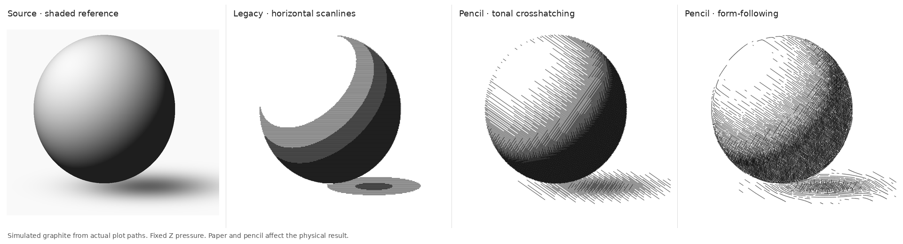

# Pencil drawing and raster import

Use **File → Import Image...**. The import dialog shows the source image beside a rendering of the actual pencil paths. Select a preset, adjust the settings, then use **Update Preview** and **Import Drawing**. The imported geometry is exactly the geometry shown in the preview.

To change an imported drawing, select it and use **Edit → Adjust Image Hatching...**. The app keeps its position, scale and rotation. If the source image has moved, select its new location. Existing paths remain available if the source is missing or the dialog is cancelled.



## Drawing styles

| Style | How it produces tone | Intended use |
|---|---|---|
| Tonal crosshatching | Long angled strokes with continuously varying density. Darker regions receive extra directions. | Photos, portraits, still life and predictable pencil shading. |
| Form-following pencil | Curved, spaced strokes follow a smoothed local image direction. Shadows receive additional directions. | Organic textures and more curved hatching. |
| Legacy horizontal scanlines | Horizontal runs selected by a small set of darkness thresholds. | Logos and high-contrast line art. |

Pencil modes preserve grayscale information. They do not reduce a photograph to its outer edges. White regions remain unmarked. Separate hatch strokes always lift the pencil during G-code export, even if the global join tolerance would otherwise connect them.

Form-following mode uses local brightness gradients and a smoothed structure tensor. It cannot infer a real 3D surface or understand anatomy. Inspect its preview around eyes, hair, fine texture and flat backgrounds. Crosshatching is the more predictable starting point for a portrait.

## Presets

Values refer to the physical drawing on paper. The selected target dimensions are retained when you change a preset.

| Preset | Sample distance | Minimum spacing | Pencil width | Shadow layers |
|---|---:|---:|---:|---:|
| Pencil · balanced | 0.20 mm | 0.42 mm | 0.30 mm | 4 |
| Pencil · fine portrait | 0.14 mm | 0.30 mm | 0.22 mm | 5 |
| Pencil · form-following | 0.20 mm | 0.42 mm | 0.30 mm | 3 |
| Pencil · bold contrast | 0.20 mm | 0.42 mm | 0.30 mm | 5 |
| Line art · legacy scanlines | 0.35 mm | 0.45 mm | 0.30 mm | 1 |

Start with **Pencil · balanced**. Use **Pencil · fine portrait** after the stroke width and pen height are calibrated. More detail increases the number of pen lifts and the physical drawing time.

## Tone and stroke controls

| Setting | Effect |
|---|---|
| Target width / Max height | Limits the physical image size. Aspect ratio is preserved. |
| Sample distance | Sets image detail in millimetres. A smaller value retains finer detail. It does not set hatch spacing. |
| Minimum hatch spacing | Sets the densest spacing within one hatch direction. Lighter regions receive fewer strokes. |
| Shadow layers / directions | Sets the maximum number of hatch directions. Extra directions appear as the required darkness increases. In legacy mode, these are parallel lines within each scan row. |
| Main hatch angle | Rotates the first direction. Later directions cross it. |
| Measured pencil width | Controls tone allocation and simulated stroke width. Measure a real plotted stroke. Changing this setting does not change the pencil tip or its Z height. |
| Stroke darkness | Approximates the opacity of one graphite stroke. A lower value requests more overlapping strokes for the same target darkness. |
| Highlight cutoff | Leaves very light regions as white paper. A high value removes subtle face and surface detail. Pencil modes remap the remaining tone range continuously. |
| Contrast | Increases separation between light and dark. Excessive contrast clips useful midtones. |
| Tone gamma | Below 1 darkens midtones. Above 1 lightens them. |
| Use full source tonal range | Applies a 0.5% histogram cutoff before tone conversion. Disable it when the source already has the intended tonal range. |
| Noise smoothing | Reduces image noise before generating strokes. A high value removes fine detail. |
| Direction smoothing | Smooths the local orientation in form-following mode. It does not blur the tone map. |
| Stroke length | Limits the approximate length of a curved flow stroke. Strokes stop earlier at highlights, image boundaries or nearby strokes. |
| Reproducible seed | Makes flow placement repeatable with the same source and settings. |
| Minimum stroke length | Removes short fragments. A high value can remove eyelashes and small highlights around edges. |
| Merge gaps | Applies only to legacy scanlines. Pencil modes do not bridge highlight gaps. |

## How the pencil modes work

1. Apply EXIF orientation. Composite transparent areas onto white paper.
2. Resize the grayscale source to a physical sampling grid.
3. Apply optional tonal range adjustment, noise smoothing, contrast and gamma.
4. Preserve highlights and map the remaining values to continuous darkness.
5. Estimate the graphite coverage from measured stroke width, spacing and stroke darkness.
6. Allocate the required optical density across successive hatch directions.
7. Generate either long straight marks with low-discrepancy density selection or spaced, curved flow strokes.
8. Clip paths to the drawing area. Remove fragments below the selected minimum length.
9. Render those exact paths using the entered stroke width and opacity.
10. Save the paths and import settings in the project. The original bitmap is not required to reopen or export the saved drawing.

The preview is an approximation of translucent graphite on white paper. Pencil hardness, tip wear, paper texture, speed, holder compliance and actual force affect the plotted result. This version uses one calibrated pen-down Z. It does not vary pressure with image darkness, smear graphite or add an artificial pencil texture to the preview.

## Physical setup and drawing time

Measure a stroke made by the mounted pencil at the intended speed and pen-down Z. Enter its width. Match stroke darkness approximately to that test. Use the shaded reference image in `examples/pencil_still_life.png` to compare the physical result with the preview.

A smaller hatch spacing does not guarantee a better result if the pencil is too blunt. It can fill highlights and produce excessively dark shadows. Keep the pencil sharp and use a holder that maintains consistent contact.

The export preview reports a lower bound for motion time. It includes XY drawing, XY travel and known Z lifts at the configured feed rates. It excludes homing, acceleration, dwell, custom start/end moves and firmware limits. Short paths can take substantially longer on the machine than this lower bound.

**Full retract between strokes** remains enabled by default for compatibility. When disabled, travel between strokes uses the configured **Pen-up Z**. Initial and final moves still use **Retract Z**. Disable full retract only after Pen-up Z clears the paper and all obstacles along the travel path. Use the smallest calibrated lift that provides the required clearance. Large repeated Z moves can dominate the duration of a detailed drawing.

The export preview hides pen-up travel by default. Enable **Show pen-up travel** to inspect it. The on-screen G-code text is limited to 4,000 lines; **Save G-Code** exports all lines.

## Repeatable visual comparison

```bash
python tools/render_pencil_demo.py
```

This creates a known shaded sphere and compares the legacy tone rule with the two pencil modes. No network connection or AI image model is needed.

For your own photo:

```bash
python tools/render_pencil_demo.py --input portrait.jpg --output comparison.png
```

## Resource limits

The importer rejects excessive requests instead of allocating unbounded work. Limits include 4 million image samples, 30 million estimated straight-hatch samples, 100,000 strokes, 350,000 flow seeds per layer and 1.5 million flow integration steps. The dialog runs conversion in a worker thread and supports cancellation. Increase sample distance or spacing, reduce image size, or use fewer shadow layers if a limit is reached.
